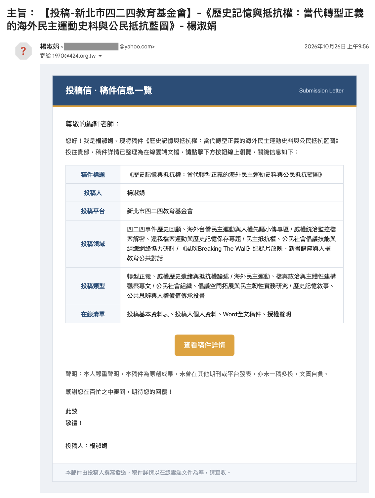
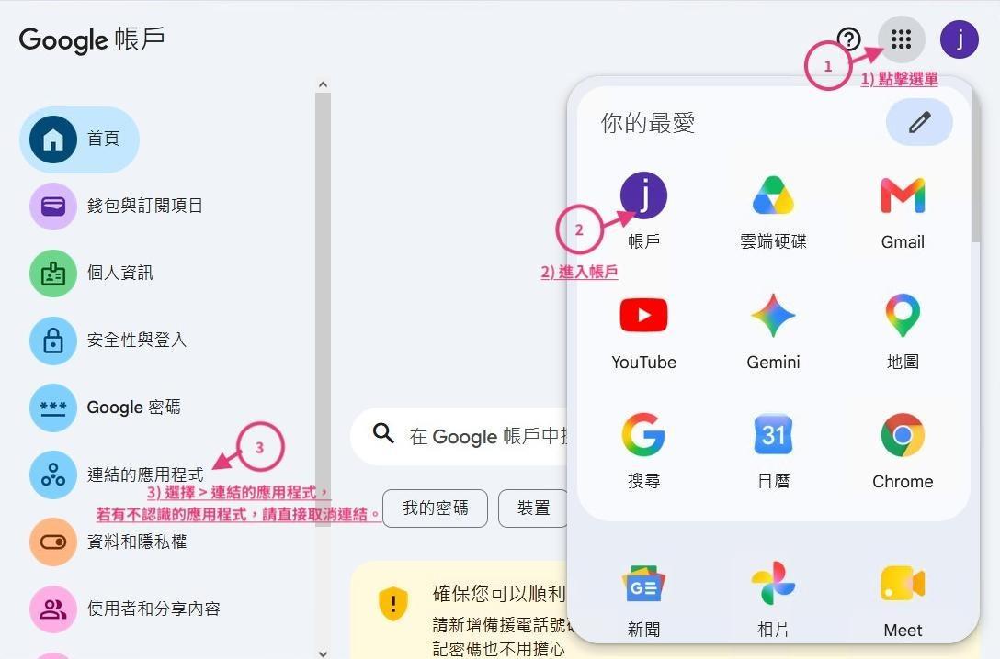

# 【公民社會威脅速報】釣魚信如何取得 Google 帳號的資料存取權？

今年 10 月，OCF 收到來自四二四教育基金會的資安事件通報，分析確認這是一起針對台灣多個 NGO、媒體與政府組織的攻擊，根據我們目前掌握的資訊，**這波攻擊來自國家資助的駭客組織**。透過誘導收件者輸入帳號密碼，授權不明應用程式，讓 Google 帳號中的資料暴露於風險之中。

<!-- more -->

## 發生了什麼事？

攻擊者長期關注台灣民主與人權倡議團體的工作方向與倡議議題，以組織關心的議題包裝釣魚郵件，吸引收件者點擊信中的按鈕。請見下方的釣魚信件，攻擊者以投稿為由，並以基金會的實際工作內容設定稿件名稱與投稿領域，藉此引導收件者點擊「查看稿件詳情」。

{ .article-image .article-image--portrait }

釣魚信件截圖經四二四教育基金會同意授權 OCF 使用。

點擊後會跳轉至 Google 帳號密碼登入或應用程式授權畫面。若不慎授權不明應用程式存取帳號資料，攻擊者就可能取得 Google 雲端硬碟、電子郵件的存取權限，掌握帳號中的工作資料。

## 我們做了什麼？

OCF 與 CSCS 社群接獲資訊後，第一時間向 Google 通報這起事件，經 Google 確認後已經下架相關已知惡意應用程式，為了避免公民團體遭受相同的攻擊，請立即採取我們建議的檢查行動。

## 你該採取什麼行動？

**請用 1 分鐘檢查 Google 帳號「連結的應用程式」，**確認是否有不認識的應用程式取得存取權限。如果你有多個 Google 帳號，請切換帳號，分別完成檢查。也可以這份檢查方式分享給他人，讓帳號授權的確認成為日常資安維護的一部分。

### 方法一：直接前往設定頁面

1. 前往 Google 帳戶「連結的應用程式」頁面（`https://myaccount.google.com/linkedapps`）
2. 查看「連結的應用程式」，發現不認識、沒有使用過的應用程式，點進去移除其存取權限

### 方法二：從 Google 帳戶進行設定

1. 點擊 Google 頁面右上角頭像旁的應用程式選單
2. 選擇「帳戶」
3. 查看「連結的應用程式」，發現不認識、沒有使用過的應用程式，點進去移除其存取權限

{ .article-image }

近期台灣公民社會出現許多偽冒成熟悉的合作對象的針對性釣魚信，請注意避免點擊任何可疑連結，或將帳號資料授權給不熟悉的應用程式，有任何疑慮務必以另一個聯繫管道向寄件者查證。

若對這次事件有任何問題，歡迎來信至 [ssd@ocf.tw](mailto:ssd@ocf.tw)。

## 參考資料

- [管理 Google 帳戶與第三方應用程式之間的連結](https://support.google.com/accounts/answer/13533235?hl=zh-Hant)

